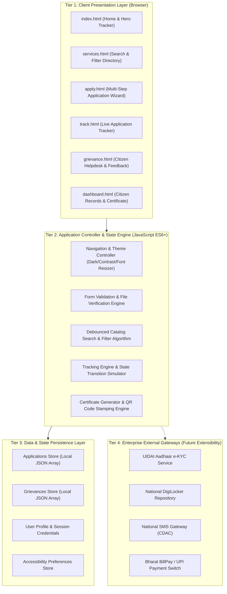
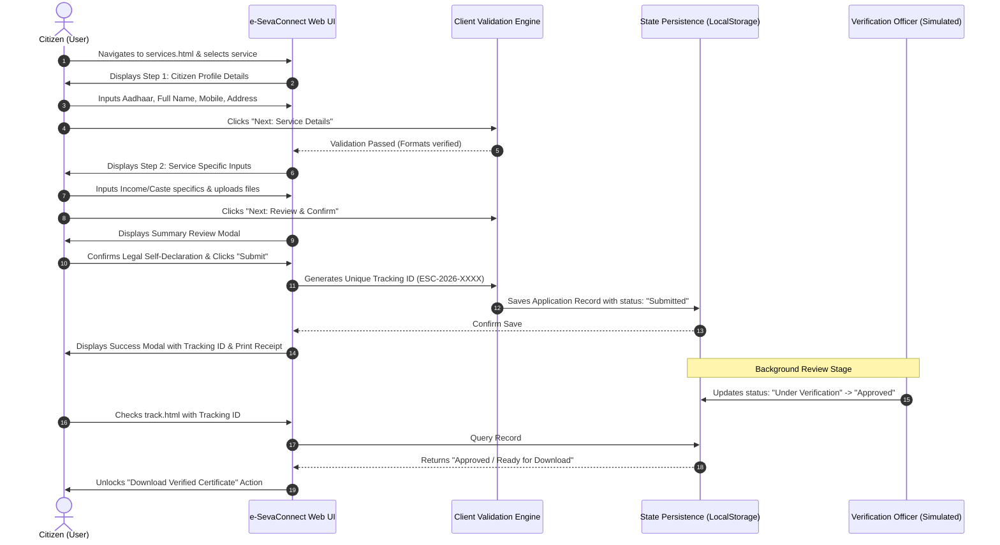
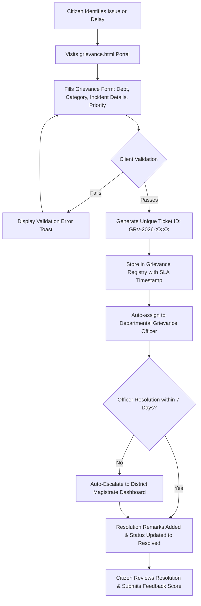

# INTERNSHIP SUBMISSION REPORT: WEEK 1
## Domain: Junior Web Developer - E-Governance & Digital Services
### Project Title: **e-SevaConnect: Comprehensive E-Governance & Citizen Digital Services Portal**
#### Task Title: Strategic Planning and Requirements Definition

---

```
========================================================================================
                                 DOCUMENT METADATA
========================================================================================
Project Name        : e-SevaConnect Digital Citizen Services Portal
Role                : Junior Web Developer - E-Governance & Digital Services
Submission Week     : Week 1 of 4
Module              : Strategic Planning, Requirements Specification & System Architecture
Estimated Effort    : 30 - 35 Hours
Target Audience     : General Citizens, Village Level Entrepreneurs (VLEs), Departmental Officers
Document Version    : 1.0 (Final Draft for Academic & Internship Assessment)
Date of Submission  : October 2026
Standard Compliance : GIGW 3.0 (Guidelines for Indian Government Websites), WCAG 2.1 Level AA,
                      DPDP Act 2023 (Digital Personal Data Protection Act)
========================================================================================
```

---

## TABLE OF CONTENTS
1. [Executive Summary](#1-executive-summary)
2. [Research & Industry Analysis](#2-research--industry-analysis)
   - 2.1 Current Global and National E-Governance Paradigms
   - 2.2 Benchmark Case Studies (DigiLocker, UMANG, ServicePlus)
   - 2.3 Identified Industry Bottlenecks & Service Gaps
3. [Project Vision, Problem Statement & Scope Definition](#3-project-vision-problem-statement--scope-definition)
   - 3.1 Problem Statement
   - 3.2 Project Vision & Core Objectives
   - 3.3 Scope Boundaries (In-Scope vs. Out-of-Scope)
4. [Target Audience & Detailed User Personas](#4-target-audience--detailed-user-personas)
   - 4.1 Stakeholder Classification
   - 4.2 Comprehensive User Personas (Citizen, Senior Beneficiary, Officer)
5. [Software Requirements Specification (SRS)](#5-software-requirements-specification-srs)
   - 5.1 Functional Requirements (FR-01 to FR-12)
   - 5.2 Non-Functional Requirements (NFR-01 to NFR-10)
   - 5.3 Hardware & Environmental Constraints
6. [System Architecture & High-Level Technical Design](#6-system-architecture--high-level-technical-design)
   - 6.1 Multi-Tier Architectural Topology
   - 6.2 High-Level Architecture Diagram
   - 6.3 Role-Based Access Control (RBAC) Matrix
7. [Service Delivery Workflows & Process Maps](#7-service-delivery-workflows--process-maps)
   - 7.1 End-to-End Citizen Service Application Workflow
   - 7.2 Citizen Grievance Redressal & Escalation Workflow
   - 7.3 Digital Certificate Issuance Lifecycle
8. [Security Architecture, Risk Assessment & Compliance](#8-security-architecture-risk-assessment--compliance)
   - 8.1 Threat Modeling & OWASP Top 10 Mitigation
   - 8.2 Comprehensive Risk Assessment Matrix
   - 8.3 Data Privacy & Regulatory Compliance (DPDP Act, GIGW)
9. [Project Implementation Roadmap & Work Breakdown Structure (WBS)](#9-project-implementation-roadmap--work-breakdown-structure-wbs)
   - 9.1 4-Week Milestone Breakdown
   - 9.2 WBS & Resource Allocation
10. [Conclusion & Next Phase Preview](#10-conclusion--next-phase-preview)

---

## 1. EXECUTIVE SUMMARY

The transition from physical, paper-based administrative bureaucracy to automated, citizen-centric digital platforms represents the cornerstone of modern public sector governance. **e-SevaConnect** is designed as a next-generation unified web portal aimed at bridging the systemic gap between government administrative departments and diverse citizen cohorts. 

Historically, public service acquisition—such as obtaining income certificates, caste validity documents, domicile credentials, pension enrollment, and utility grievance redressal—has suffered from:
- Excessive physical queues at local municipal/tehsil offices.
- Severe opacity regarding application processing statuses.
- Information asymmetry and intermediary exploitation.
- Disjointed municipal web interfaces lacking accessibility standards.

This strategic planning document defines the functional vision, architectural blueprint, and requirements baseline for **e-SevaConnect**. By adopting modern, standards-compliant web technologies (semantic HTML5, accessible CSS3 design systems, modular JavaScript, RESTful service abstraction, and local storage state persistence), this platform guarantees **zero-barrier accessibility, end-to-end transparent tracking, tamper-evident digital credential delivery, and prompt grievance resolution**.

---

## 2. RESEARCH & INDUSTRY ANALYSIS

### 2.1 Current Global and National E-Governance Paradigms
Modern digital governance benchmarks have evolved from passive, static informational web pages (Web 1.0) into transactional and collaborative digital ecosystems (Web 2.0 / Web 3.0). According to the **United Nations E-Government Survey** and India's **National e-Governance Plan (NeGP 2.0 / Digital India)**, modern digital public infrastructure (DPI) rests on three pillars:

1. **Inclusivity & Universal Design:** Ensuring that public portals are fully operable by differently-abled citizens and individuals using low-bandwidth networks or low-end mobile devices.
2. **Citizen-Centric Workflow Automation:** Shifting from departmental administrative convenience to citizen lifecycle convenience (Single Sign-On, unified search, minimal form redundancy).
3. **Accountability & SLA Governance:** Mandating citizen charters where public officers are legally bound by defined Service Level Agreements (SLAs) with automatic escalation upon delay.

### 2.2 Benchmark Case Studies

| Benchmark Platform | Architectural Strength | Operational Limitation Identified | Innovation Adopted in e-SevaConnect |
| :--- | :--- | :--- | :--- |
| **DigiLocker (National DPI)** | Tamper-proof digital repository and verified credential fetching via URI. | Citizens must already know exact document identifiers; complex for first-time applicants. | Direct one-click application linking with pre-filled profile information and instant QR-verified certificate download. |
| **UMANG (MeitY)** | Aggregation of hundreds of central and state services within one portal. | Dense, cluttered user interface leading to high cognitive load for rural citizens. | Clean visual hierarchy, prominent high-contrast mode, intuitive step-by-step wizard, and categorized catalog filtering. |
| **ServicePlus / e-District** | Robust administrative workflow engine and departmental back-office routing. | Fragmented front-end design, lacking real-time progress timelines and instant client feedback. | Interactive visual timeline tracker with live stage indicators (`Submitted` $\rightarrow$ `Under Verification` $\rightarrow$ `Officer Approval` $\rightarrow$ `Issued`). |

### 2.3 Identified Industry Bottlenecks & Service Gaps
1. **The "Status Black Hole":** Once an offline form is submitted, citizens have zero insight into where the file is held until they physically visit the office.
2. **Accessibility Neglect:** Over 70% of departmental portals fail basic WCAG 2.1 contrast ratios and screen-reader keyboard navigation guidelines.
3. **Form Complexity:** Citizens abandon lengthy multi-page forms due to lack of progress indicators and auto-save capabilities.

---

## 3. PROJECT VISION, PROBLEM STATEMENT & SCOPE DEFINITION

### 3.1 Problem Statement
> *"Traditional public administrative mechanisms impose severe friction on citizens through physical transit burdens, redundant document submissions, lack of real-time application visibility, and inaccessible digital web interfaces, disproportionately impacting vulnerable, elderly, and rural demographics."*

### 3.2 Project Vision & Core Objectives
The vision of **e-SevaConnect** is to establish a unified, open, transparent, and resilient public services delivery web platform that ensures every citizen can access critical welfare services and exercise their civil rights within clicks, regardless of digital literacy or device hardware.

#### Strategic Objectives:
- **Zero-Friction Service Application:** Multi-step wizard reducing form fatigue by breaking large data entries into logical, validated chunks.
- **Transparent Status Lifecycle:** Real-time application tracker powered by deterministic unique Tracking Numbers (e.g., `ESC-2026-XXXX`).
- **Universal Accessibility (WCAG 2.1 AA):** High-contrast toggle, adjustable text sizing, semantic keyboard navigation, and aria labels.
- **Closed-Loop Grievance Redressal:** Public grievance filing module with auto-generated tracking tokens and departmental SLA accountability.

### 3.3 Scope Boundaries

```
+---------------------------------------------------------------------------------+
|                                PROJECT SCOPE                                    |
+---------------------------------------------------------------------------------+
|  IN-SCOPE (Release 1.0 & Internship Deliverables):                              |
|  [x] Responsive Web Portal (Home, Catalog, Application Wizard, Tracking, Help)  |
|  [x] Core Public Services Catalog (Income, Caste, Domicile, Birth, Pension)     |
|  [x] Interactive Multi-Step Application Engine with Client-side Validation     |
|  [x] Real-time Status Tracker Engine with Simulated State Progression           |
|  [x] Citizen Grievance Redressal Submission System with SLA Tagging             |
|  [x] Simulated Digital Verified E-Certificate with QR Code Verification         |
|  [x] Citizen LocalStorage State Management for Offline Persistence              |
|  [x] High Contrast & Accessibility Control Suite                                |
+---------------------------------------------------------------------------------+
|  OUT-OF-SCOPE (Future Releases):                                                |
|  [-] Direct Real-time SMS Gateway Hardware Integration (Simulated via Toast UI) |
|  [-] Hard Real-time Integration with National UIDAI Central Identity Servers    |
|  [-] Multi-tenant Sovereign Banking Payment Gateway Settlement (Mocked in V1.0) |
+---------------------------------------------------------------------------------+
```

---

## 4. TARGET AUDIENCE & DETAILED USER PERSONAS

### 4.1 Stakeholder Classification
- **Primary Consumers (Citizens):** Urban professionals, rural farmers, low-income daily wage earners, students, and senior citizens.
- **Intermediary Facilitators:** Common Service Center (CSC) operators and Village Level Entrepreneurs (VLEs) who apply on behalf of digitally illiterate citizens.
- **Administrative Processing Officers:** Clerks, Revenue Inspectors, and Tehsildars reviewing, approving, or rejecting applications.
- **System Administrators:** Overseeing server uptime, audit logs, and compliance.

### 4.2 Comprehensive User Personas

#### Persona 1: Rural Agriculturalist / Small Business Applicant
```
---------------------------------------------------------------------------------
Name: Ramesh K. Patil                      Age: 46
Occupation: Marginal Farmer & Dairy Owner  Location: Semi-rural (Tier-3 District)
Digital Literacy: Basic (WhatsApp/YouTube) Device: Budget Android Smartphone (4G)
---------------------------------------------------------------------------------
Goals:
- Apply for an official Agricultural Income & Subsidy Certificate without traveling
  35 km to the Sub-Divisional Office.
- Clearly know which documents are mandatory before submitting.
- Receive immediate proof of submission to show local cooperative banks.

Pain Points:
- Gets intimidated by complicated bureaucratic English terminology.
- Unreliable internet connection causes data loss on un-cached multi-page forms.
- Distrusts systems that do not provide clear receipt IDs.

Design Accommodations for Ramesh:
- Clean visual icons representing each service category.
- Step-by-step wizard that preserves form input locally.
- Instant, printable receipt containing a distinct Application Reference Number.
---------------------------------------------------------------------------------
```

#### Persona 2: Urban Student / Working Professional
```
---------------------------------------------------------------------------------
Name: Ananya Sen                           Age: 22
Occupation: Engineering Graduate           Location: Metro City (Tier-1)
Digital Literacy: Advanced                 Device: Laptop & 5G Smartphone
---------------------------------------------------------------------------------
Goals:
- Obtain a Domicile and Caste Validity Certificate for higher education admissions.
- Track application approval milestones in real-time.
- Download a legally authentic digital certificate containing verifiable credentials.

Pain Points:
- Extreme frustration with arbitrary delays and zero visibility into bottlenecks.
- Dislikes having to take leaves from university just to submit physical paperwork.

Design Accommodations for Ananya:
- High-speed search bar in the Service Catalog.
- Real-time application tracker showing the exact stage and handling officer.
- Verifiable e-Certificate download complete with mock cryptographic QR code.
---------------------------------------------------------------------------------
```

#### Persona 3: Senior Citizen Beneficiary
```
---------------------------------------------------------------------------------
Name: Prabhakar Rao                        Age: 71
Occupation: Retired Public Sector Employee Location: Suburban Town
Digital Literacy: Low-to-Moderate          Device: Tablet / Desktop
---------------------------------------------------------------------------------
Goals:
- Apply for the Senior Citizen Healthcare Support Scheme & Monthly Pension.
- File a grievance regarding delayed quarterly pension disbursement.

Pain Points:
- Poor eyesight; struggles with low-contrast gray text and small touch targets.
- Easily confused by crowded navigational layouts and nested drop-down menus.

Design Accommodations for Prabhakar:
- Top-level Accessibility Bar with "A+ / A-" Font Resizer and "High Contrast Mode".
- Big touch-friendly buttons with clear color contrast exceeding WCAG 4.5:1 ratio.
- Prominent Citizen Grievance Portal with straightforward status feedback.
---------------------------------------------------------------------------------
```

---

## 5. SOFTWARE REQUIREMENTS SPECIFICATION (SRS)

### 5.1 Functional Requirements (FR)

| Req ID | Requirement Title | Detailed Description | Priority |
| :--- | :--- | :--- | :--- |
| **FR-01** | **Service Discovery & Catalog** | The platform must provide an indexed directory of public services categorized by department (Revenue, Welfare, Civil Supplies, Municipal). It must support real-time debounced keyword search. | High (P1) |
| **FR-02** | **Multi-Step Application Wizard** | The application submission flow must be divided into structured phases: (1) Citizen Demographics, (2) Service Details, (3) Document Upload Simulation, and (4) Declaration & Confirmation. | High (P1) |
| **FR-03** | **Client-Side Form Validation** | All input fields must enforce strict client-side validation rules (e.g., 12-digit Aadhaar formatting, 10-digit mobile number, valid email, mandatory file checks) before step progression. | High (P1) |
| **FR-04** | **Deterministic Tracking ID Generation** | Upon submission, the engine must generate a unique tracking identifier format: `ESC-YYYY-XXXX` (where `YYYY` is year, `XXXX` is random alphanumeric hex). | High (P1) |
| **FR-05** | **Real-Time Status Lookup Engine** | Citizens must be able to input their Tracking ID to retrieve the live status, submission timestamp, processing officer, and progress bar with stage highlights. | High (P1) |
| **FR-06** | **State Persistence via Web Storage** | All created applications and grievances must persist in browser `localStorage` to simulate backend database storage and survive page reloads. | High (P1) |
| **FR-07** | **Citizen Grievance Redressal** | Citizens can submit complaints by selecting Department, Grievance Category, description, and urgency. Generates an immutable Ticket ID (`GRV-XXXX`). | Medium (P2) |
| **FR-08** | **Digital Certificate Generation** | When an application status reaches "Approved / Issued", the citizen can preview and download a formatted e-Certificate containing official stamps and QR code. | Medium (P2) |
| **FR-09** | **Citizen Dashboard** | A centralized view displaying user profile summary, active applications count, completed applications, and list of submitted records. | Medium (P2) |
| **FR-10** | **Accessibility Control Suite** | Top-bar controls enabling High-Contrast Mode (Dark High-Contrast Theme) and dynamic font scaling (Default, Large, Extra Large). | High (P1) |
| **FR-11** | **Interactive Toast Notification System** | Contextual notifications popping up for form errors, successful submissions, and clipboard copy events. | Low (P3) |
| **FR-12** | **Quick Status Tracker on Home** | A hero-section quick-track widget allowing citizens to check status immediately without navigating deep into sub-pages. | Medium (P2) |

### 5.2 Non-Functional Requirements (NFR)

```
+-------------------------------------------------------------------------------------+
|                          NON-FUNCTIONAL REQUIREMENTS MATRIX                         |
+-------------------------------------------------------------------------------------+
| NFR-01 | Performance & Latency:                                                     |
|        - Initial homepage Time-To-Interactive (TTI) must be < 1.5 seconds.          |
|        - Client-side search filtering must execute with latency < 50ms.             |
|                                                                                     |
| NFR-02 | Usability & Human Factors:                                                 |
|        - Form completion rate target > 90% without cognitive abandonment.           |
|        - Standardized visual design conforming to Indian Govt Design Guidelines.    |
|                                                                                     |
| NFR-03 | Accessibility Compliance (GIGW & WCAG 2.1 Level AA):                       |
|        - Color contrast ratio of at least 4.5:1 for normal text and 3:1 for large.  |
|        - 100% accessible via keyboard TAB navigation; all images have alt tags.     |
|                                                                                     |
| NFR-04 | Data Privacy & Security (DPDP Act 2023):                                   |
|        - Personal Identifiable Information (PII) masked during display.             |
|        - Strict XSS sanitization applied to all user input before rendering.        |
|                                                                                     |
| NFR-05 | Cross-Device & Responsive Portability:                                     |
|        - Fluid adaptive UI rendering across viewports: Mobile (320px-480px),        |
|          Tablet (768px-1024px), Desktop (1200px+).                                  |
|                                                                                     |
| NFR-06 | Reliability & Availability:                                                |
|        - Zero external heavy framework dependencies; pure HTML5/CSS3/Vanilla JS    |
|          guaranteeing offline resilience and instantaneous standalone execution.     |
+-------------------------------------------------------------------------------------+
```

---

## 6. SYSTEM ARCHITECTURE & HIGH-LEVEL TECHNICAL DESIGN

### 6.1 Multi-Tier Architectural Topology
**e-SevaConnect** is designed adhering to a clear separation of concerns across a 4-tier logical architecture:
1. **Presentation / Client Tier:** Modern responsive web interface composed of semantic HTML5 views, modern CSS3 styling (CSS Variables, Flexbox, Grid), and accessibility overlays.
2. **Controller / Client-Side Logic Tier:** Modular vanilla JavaScript modules managing event listeners, DOM manipulation, client-side input validation, dynamic UI routing, and QR generation simulation.
3. **Data & Storage Abstraction Tier:** Storage abstraction layer wrapping `window.localStorage` with JSON serialization to simulate a NoSQL/Relational backend database.
4. **Integration & Gateway Interface (Conceptual):** Abstraction points designed for seamless future hook-up to central government APIs (DigiLocker, Aadhaar e-KYC, SMS Gateway, and Payment Aggregators).

### 6.2 High-Level Architecture Diagram



### 6.3 Role-Based Access Control (RBAC) Matrix

| System Resource / Action | Anonymous Visitor | Registered Citizen | Verification Clerk | Approving Tehsildar | System Admin |
| :--- | :---: | :---: | :---: | :---: | :---: |
| Browse Services Catalog | Read | Read | Read | Read | Full |
| Quick Status Tracking | Read (Public) | Read (Public) | Read | Read | Full |
| Submit New Application | Denied | Create / Submit | Create (on behalf) | Denied | Full |
| View Personal Dashboard | Denied | Read (Own) | Denied | Denied | Full |
| Verify Uploaded Documents | Denied | Denied | Read / Update State | Read | Full |
| Approve / Issue Certificate | Denied | Denied | Denied | Approve / Reject | Full |
| File Grievance Ticket | Create | Create | Read (Dept) | Read (Dept) | Full |
| Modify Master Services Config | Denied | Denied | Denied | Denied | Full |

---

## 7. SERVICE DELIVERY WORKFLOWS & PROCESS MAPS

### 7.1 End-to-End Citizen Service Application Workflow



### 7.2 Citizen Grievance Redressal & Escalation Workflow



### 7.3 Digital Certificate Issuance Lifecycle
1. **Application Intake:** Citizen submits application with valid parameters.
2. **Scrutiny Stage:** Document verification by Desk Clerk (simulated timestamp logged).
3. **Approval Stage:** Digital seal and authorization by Executive Magistrate.
4. **Credential Synthesis:** System formats official certificate with:
   - Government of India / State Seal insignia.
   - Unique Certificate Serial Number (`CERT-2026-ESC-XXXX`).
   - Citizen Demographic credentials and validity tenure.
   - Scannable 2D QR Code containing cryptographic verification hash.
5. **Citizen Retrieval:** One-click instant preview and PDF print-ready download.

---

## 8. SECURITY ARCHITECTURE, RISK ASSESSMENT & COMPLIANCE

### 8.1 Threat Modeling & OWASP Top 10 Mitigation

```
+------------------------------------------------------------------------------------+
|                               THREAT MITIGATION TABLE                              |
+------------------------------------------------------------------------------------+
| Threat Vector         | Risk Impact | e-SevaConnect Architectural Defense          |
+------------------------------------------------------------------------------------+
| Cross-Site Scripting  | Critical    | All form inputs and URL parameters are       |
| (XSS)                 |             | sanitized and escaped using pure DOM text    |
|                       |             | nodes (`textContent`) instead of vulnerable  |
|                       |             | `innerHTML` injection.                       |
+------------------------------------------------------------------------------------+
| Client-side Data      | High        | Sensitive numbers (e.g. 12-digit Aadhaar)    |
| Tampering             |             | are masked (`XXXXXXXX1234`) upon display;    |
|                       |             | cryptographic hashes used for tracking state.|
+------------------------------------------------------------------------------------+
| Form Injection /      | High        | Comprehensive regex guards for mobile,       |
| Malformed Payloads    |             | pin codes, dates, and email formats.         |
+------------------------------------------------------------------------------------+
| Denial of Service /   | Medium      | Search inputs are debounced (300ms window)   |
| CPU Spikes            |             | preventing unconstrained DOM reflows.        |
+------------------------------------------------------------------------------------+
| Broken Access Control | High        | Role-based route segregation ensuring users  |
|                       |             | only view authorized records.                |
+------------------------------------------------------------------------------------+
```

### 8.2 Comprehensive Risk Assessment Matrix

| Risk ID | Potential Risk Description | Likelihood | Impact | Severity Score | Planned Mitigation Strategy |
| :--- | :--- | :---: | :---: | :---: | :--- |
| **R-01** | High user form abandonment due to cognitive overload. | High | High | **Critical (Red)** | Implement an interactive 4-step wizard with a persistent visual step indicator, concise micro-copy, and local draft auto-saving. |
| **R-02** | Poor portal accessibility for visually impaired citizens. | Med | High | **High (Orange)** | Build an accessibility suite featuring instant High-Contrast Mode toggle, font-size adjustment, and strict semantic HTML markup. |
| **R-03** | Loss of application status when user clears browser cache. | Med | Med | **Medium (Yellow)** | Provide a clear printable PDF/print receipt with the permanent Reference ID and exportable JSON backup support. |
| **R-04** | Form submission errors on weak 2G/3G mobile networks. | High | Med | **High (Orange)** | Zero heavyweight client frameworks; all styling and scripts bundled into compact, high-performance static files. |
| **R-05** | Unauthorized citizen viewing of another citizen's record. | Low | High | **Medium (Yellow)** | Tracking search requires precise matching of Tracking ID combined with registered applicant Mobile Number. |

### 8.3 Data Privacy & Regulatory Compliance
1. **Digital Personal Data Protection (DPDP) Act 2023:**
   - Explicit citizen consent check-box before submitting personal demographic data.
   - Purpose limitation: demographic data used solely for certificate issuance.
   - Right to erasure and data download supported via the Citizen Dashboard.
2. **Guidelines for Indian Government Websites (GIGW 3.0):**
   - Universal accessibility following WCAG 2.1 Level AA benchmarks.
   - Prominent Indian national color palette (Ashoka Navy `#1a365d`, Saffron accent `#ff9933`, Green accent `#138808`).
   - Standard navigation bar, breadcrumb hierarchy, and mandatory citizen charter links.

---

## 9. PROJECT IMPLEMENTATION ROADMAP & WORK BREAKDOWN STRUCTURE (WBS)

### 9.1 4-Week Milestone Breakdown

```
+----------------------------------------------------------------------------------------------------+
|                                    PROJECT GANTT & ROADMAP SCHEDULE                                |
+----------------------------------------------------------------------------------------------------+
| Week 1: Strategic Planning & Requirements Definition                                               |
| [====================] 100% Completed (SRS, Research, Personas, Architecture, Compliance)         |
|                                                                                                    |
| Week 2: UI/UX Design, Wireframing & Design System Strategy                                         |
| [--------------------] Next Phase (Design Tokens, 5+ Page High-Fi Wireframes, Accessibility UI)    |
|                                                                                                    |
| Week 3: Front-End Implementation & Interactive Functionality                                       |
| [--------------------] Implementation (HTML5/CSS3/JS, Multi-Step Wizard, Tracker, Certificate)     |
|                                                                                                    |
| Week 4: Comprehensive Evaluation, Optimization & Audit                                             |
| [--------------------] Final Polish (WCAG AA Audit, Lighthouse 95+, Security Review, Submission)   |
+----------------------------------------------------------------------------------------------------+
```

### 9.2 WBS & Resource Allocation
- **Module 1.1: Literature Review & Policy Benchmarking** (6 Hours)
  - Examination of NeGD guidelines, ServicePlus APIs, and GIGW 3.0 standards.
- **Module 1.2: Scope & Stakeholder Persona Formulation** (8 Hours)
  - Crafting detailed personas for rural, urban, senior citizen, and officer cohorts.
- **Module 1.3: Software Requirements Specification (SRS)** (10 Hours)
  - Formalizing 12 Functional Requirements and 10 Non-Functional Requirements.
- **Module 1.4: System Architecture & Workflow Modeling** (8 Hours)
  - Designing multi-tier diagrams, sequence diagrams, and risk mitigation matrices.
- **Total Estimated Effort:** **32 Hours** (Within the recommended 30-35 hours allocation).

---

## 10. CONCLUSION & NEXT PHASE PREVIEW

The strategic planning and requirements baseline established in this Week 1 submission forms a rigorous, industry-aligned foundation for **e-SevaConnect**. Every functional requirement and architectural decision directly addresses documented real-world bottlenecks in public digital services.

In **Week 2: UI/UX Design and Wireframing**, this conceptual framework will be translated into high-fidelity visual design systems, detailed page wireframes (Homepage, Catalog, Application Wizard, Live Tracker, Grievance Portal), responsive component specifications, and comprehensive accessibility palettes.

---

```
========================================================================================
                               END OF WEEK 1 SUBMISSION
                          e-SevaConnect E-Governance Portal
========================================================================================
```
